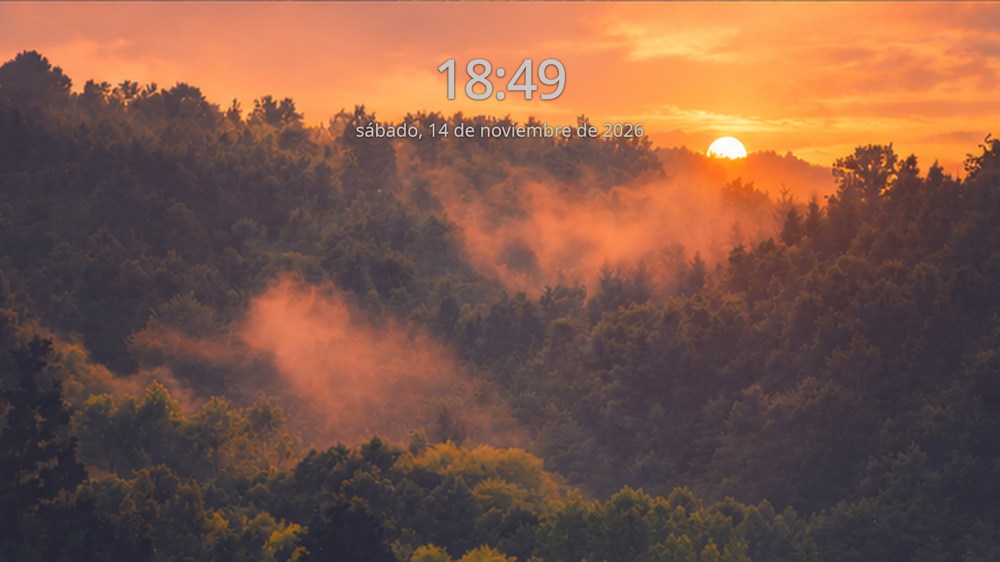
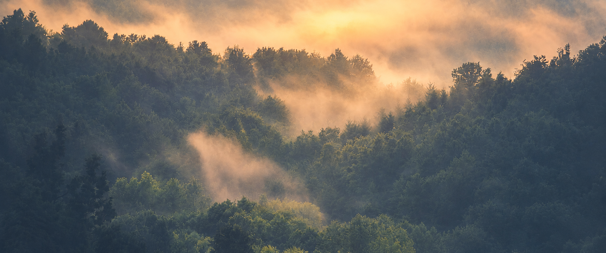
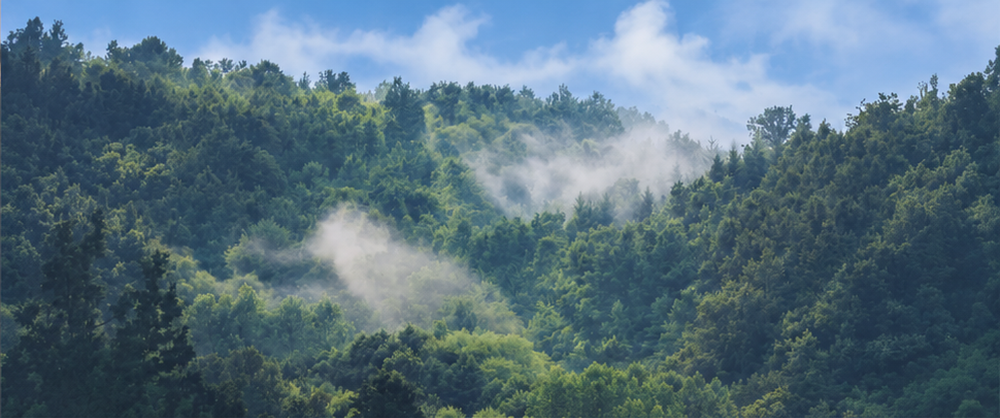
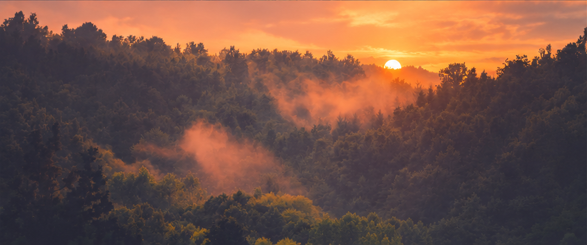
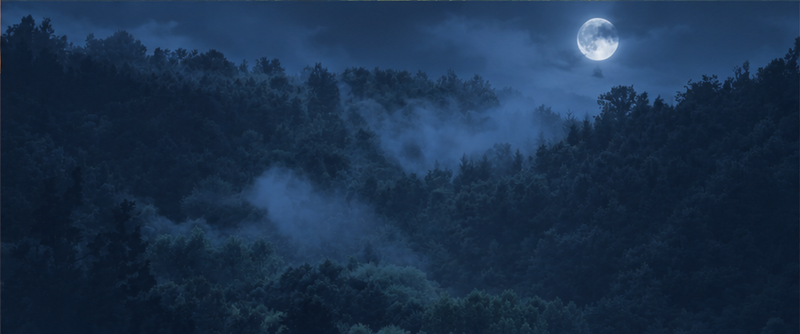

# Ansalon — tema SDDM



Tema para la pantalla de inicio de sesión [SDDM](https://github.com/sddm/sddm),
derivado del tema Breeze de KDE Plasma y adaptado a Qt 6.

## Características

- **Fondo según la hora**: cuatro imágenes de un bosque (amanecer, día,
  atardecer y noche) que se relevan con un fundido suave.
- **Entrada gradual**: al arrancar aparece primero el reloj y después los
  avatares y el formulario.
- **Fondo nítido**: solo se desenfoca al elegir un avatar o al empezar a
  escribir la contraseña.
- **Distribución ajustable**: reloj arriba, avatares y formulario en el centro
  y botones de suspender, reiniciar y apagar en el borde inferior; la altura
  del reloj y del formulario se regula desde `theme.conf`.

Todo se puede cambiar o desactivar en [Personalización](#personalización).

## Fondo según la hora

El tema elige el fondo al arrancar según la hora del sistema. Si la pantalla de
inicio de sesión sigue abierta cuando cambia la franja, el fondo nuevo releva
al anterior con un fundido de dos segundos.

| Amanecer · 06:00–09:00 | Día · 09:00–18:00 |
|:---:|:---:|
|  |  |
| **Atardecer · 18:00–21:00** | **Noche · 21:00–06:00** |
|  |  |

Las horas de cada franja y las imágenes se cambian en `theme.conf`
(`dawnHour`, `dayHour`, `duskHour`, `nightHour` y `backgroundDawn`,
`backgroundDay`, `backgroundDusk`, `backgroundNight`). Con
`timeBackground=false` se usa siempre la imagen de `background`.

## Requisitos

- `sddm` con soporte Qt 6 (`sddm-greeter-qt6`)
- `plasma-desktop` (aporta los módulos QML de Breeze que usa el tema)
- `qt6-5compat`
- Opcional: `breeze` para el cursor `breeze_cursors`

## Instalación en Arch Linux (como un paquete de AUR)

```sh
git clone https://github.com/amenish/ansalons-breeze.git
cd ansalons-breeze
makepkg -si
```

`makepkg` descarga la versión etiquetada (`v<pkgver>`) del repositorio,
construye el paquete `sddm-theme-ansalon` y lo instala con pacman. El paquete:

- instala el tema en `/usr/share/sddm/themes/ansalon/`
- añade `/usr/lib/sddm/sddm.conf.d/ansalon.conf`, que lo activa como tema
  actual (`Current=ansalon`) con el cursor `breeze_cursors`

Para desinstalarlo: `sudo pacman -R sddm-theme-ansalon`.

## Instalación manual (otras distribuciones)

```sh
sudo mkdir -p /usr/share/sddm/themes/ansalon/faces
sudo cp *.qml metadata.desktop theme.conf default-logo.svg 5120x2880.png bosque_*.png preview.png \
  /usr/share/sddm/themes/ansalon/
sudo cp faces/.face.icon /usr/share/sddm/themes/ansalon/faces/
sudo cp sddm.conf.d/ansalon.conf /etc/sddm.conf.d/
```

## Probar sin cerrar sesión

Como usuario normal (no como root):

```sh
sddm-greeter-qt6 --test-mode --theme /ruta/al/repositorio
```

## Personalización

Las opciones están en `theme.conf` (`[General]`):

| Opción       | Valores                         | Descripción                          |
|--------------|---------------------------------|--------------------------------------|
| `background` | ruta a imagen                   | Fondo de pantalla                    |
| `type`       | `image` / `color`               | Fondo con imagen o color sólido      |
| `color`      | `#rrggbb`                       | Color usado si `type=color`          |
| `showClock`  | `true` / `false`                | Muestra el reloj                     |
| `showlogo`   | `shown` / `hidden`              | Muestra el logo                      |
| `logo`       | ruta a imagen                   | Logo                                 |
| `fontSize`   | número                          | Tamaño de letra base                 |
| `timeBackground` | `true` / `false`            | Cambia el fondo según la hora; con `false` se usa `background` |
| `backgroundDawn`, `backgroundDay`, `backgroundDusk`, `backgroundNight` | ruta a imagen | Fondo de amanecer, día, atardecer y noche |
| `dawnHour`, `dayHour`, `duskHour`, `nightHour` | hora (0-23) | Hora a la que empieza cada franja (6, 9, 18 y 21) |
| `entryDuration` | milisegundos                 | Duración de cada fundido de entrada (primero el reloj, después el formulario); `0` lo desactiva |
| `blurOnInteraction` | `true` / `false`         | El fondo solo se desenfoca al elegir avatar o teclear; con `false` queda siempre nítido |
| `clockOffset` | % del alto de pantalla         | Baja (positivo) o sube (negativo) el reloj |
| `loginOffset` | % del alto de pantalla         | Baja o sube avatares y formulario, que se mueven juntos |
| `userFontSize` | puntos                        | Tamaño del nombre bajo cada avatar |

Los botones de suspender, reiniciar y apagar van fijos en el borde inferior.

Para no tocar el archivo del paquete, crea `theme.conf.user` junto a
`theme.conf` en el directorio del tema: SDDM lo lee encima y sobrescribe
solo las claves que definas.

## Licencia y créditos

Basado en el tema SDDM Breeze de KDE (David Edmundson, Aleix Pol Gonzalez,
Boudhayan Gupta y el KDE Visual Design Group). El código QML se distribuye
bajo LGPL-2.0-or-later, como el original.
